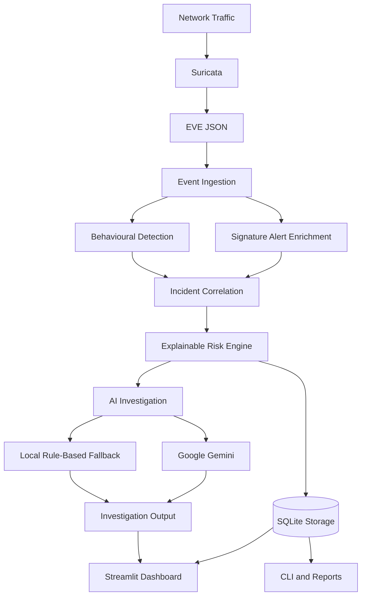

<div align="center">

# AI-Enhanced Network Intrusion Detection System

**A network security monitoring and investigation platform combining Suricata detection, behavioural analysis, incident correlation, explainable risk scoring, and AI-assisted investigation.**

[](https://www.python.org/)
[](https://suricata.io/)
[](https://streamlit.io/)
[](https://www.sqlite.org/)
[](https://ai.google.dev/)

</div>

---

## Overview

The **AI-Enhanced Network Intrusion Detection System (NIDS)** is a defensive cybersecurity project built to help monitor network activity, identify suspicious behaviour, and turn security events into actionable incident investigations.

The platform uses **Suricata** to collect network security events and perform signature-based detection. It also analyses observed flow activity to identify behavioural patterns such as TCP port scanning. Related detections can be grouped into incidents, which are assessed by a deterministic risk-scoring engine.

To support investigation, the system integrates **Google Gemini** to generate contextual explanations and response guidance. When the AI service is unavailable, a local rule-based fallback can provide a basic investigation. A Streamlit dashboard brings monitoring, incident review, and investigation into one interface.

> **Design principle:** Detection and risk scoring remain evidence-driven and deterministic. Gemini assists with investigation; it does not independently declare an incident or change its calculated risk score.

## What it does

- **Monitors network activity** through Suricata EVE JSON.
- **Detects suspicious events** using Suricata signatures and behavioural port-scan analysis.
- **Correlates related detections** into incident records within a configured time window.
- **Explains incident risk** through a deterministic score and factor-level breakdown.
- **Assists investigation** with Gemini-generated context, playbooks, and response recommendations.
- **Falls back locally** to rule-based investigation when Gemini is unavailable.
- **Persists records** using SQLite.
- **Supports analyst workflows** through a Streamlit dashboard, CLI, and report/export functions.

## Architecture



### Processing pipeline

1. Suricata observes traffic on the configured network interface.
2. Network events are written to the EVE JSON log.
3. The application ingests and enriches available events.
4. The behavioural engine analyses eligible flow events for port-scan patterns.
5. The incident engine correlates related detections.
6. The risk engine calculates a score and explains its contributing factors.
7. Gemini generates investigation guidance, or the local fallback is used.
8. The dashboard presents the resulting events, incidents, evidence, and analysis.

## Core capabilities

| Area | Capability |
|---|---|
| Network monitoring | Live Suricata EVE JSON ingestion |
| Data input | Live monitoring, EVE JSON upload, and demo events |
| Signature detection | Suricata rules-based alerts |
| Behavioural detection | TCP port-scan pattern detection |
| Incident management | Correlation of related detections |
| Risk assessment | Deterministic, explainable risk scoring |
| AI investigation | Gemini-powered alert and incident analysis |
| Fallback | Local rule-based investigation |
| Persistence | SQLite-backed records |
| Interface | Streamlit dashboard |
| Operations | CLI and report/export workflows |

## Risk scoring

The risk engine calculates an incident score from evidence-based factors. The implemented model includes:

- Detection severity
- Corroborating events
- Destination diversity
- Behavioural evidence

The dashboard displays the score alongside the points, maximum values, and explanations for each factor.

**The score is calculated by the risk engine—not by Gemini.** AI-generated investigation text can explain the findings and recommend next steps, but it does not override the deterministic calculation.

Refer to the risk-scoring implementation and tests in the repository for the exact weights, caps, and boundary behaviour.

## AI-assisted investigation

Gemini is used after detection and correlation to help an analyst understand an incident. Depending on the available evidence, the investigation can include:

- Incident assessment
- Why the events matter
- Threat context and potential impact
- Investigation playbook
- Response recommendations
- False-positive considerations

If Gemini cannot be reached or returns an unusable response, the application can use its local rule-based fallback.

AI output is **advisory**. Findings and recommendations should be checked against the underlying network evidence and the environment being monitored.

## Technology stack

- **Python** — application logic and detection workflows
- **Suricata** — network IDS and event generation
- **EVE JSON** — network event format
- **Streamlit** — monitoring and investigation dashboard
- **SQLite** — local data persistence
- **Google Gemini API** — AI-assisted investigation
- **Nmap** — controlled lab validation

## Getting started

### Prerequisites

- Linux environment (developed and tested during development on Parrot OS)
- Python version supported by the packages in `requirements.txt`
- Suricata configured to monitor the intended network interface
- Read access to the Suricata EVE JSON log for live monitoring
- Gemini API key for Gemini-powered investigation
- Nmap for authorised lab testing

### 1. Clone the repository

```bash
git clone https://github.com/prince-unk/AI-Enhanced-Network-Intrusion-Detection-System.git
cd AI-Enhanced-Network-Intrusion-Detection-System
```

### 2. Create a virtual environment

```bash
python3 -m venv .venv
source .venv/bin/activate
```

### 3. Install dependencies

```bash
python -m pip install --upgrade pip
pip install -r requirements.txt
```

### 4. Configure Gemini

Create a local `.env` file in the project root and add the API key using the variable expected by the application:

```env
GEMINI_API_KEY=your_gemini_api_key
```

Keep this file private. **Never commit `.env` or expose your API key** in screenshots, logs, or public repositories.

### 5. Configure Suricata

Ensure Suricata is running, monitoring the correct interface, and writing EVE JSON output. The development configuration used:

```text
/var/log/suricata/eve.json
```

Check the service and event log:

```bash
sudo systemctl status suricata
sudo tail -f /var/log/suricata/eve.json
```

The path may differ on your system. Use the actual configured EVE log path in the NIDS dashboard. Configure permissions so the application can read the log without unnecessarily running the entire dashboard as root.

## Run the application

### Streamlit dashboard

If the repository's launcher is present:

```bash
chmod +x run.sh
./run.sh
```

Or launch Streamlit directly:

```bash
streamlit run app.py
```

### Command-line interface

If the CLI launcher is present:

```bash
chmod +x run_cli.sh
./run_cli.sh
```

The CLI entry point is `cli.py`. Check the commands supported by your current version:

```bash
python cli.py --help
```

## Operating modes

The dashboard supports three data-source modes:

| Mode | Purpose |
|---|---|
| **Live Suricata EVE** | Monitor events from the configured live EVE JSON log |
| **Upload EVE JSON** | Analyse an EVE JSON file supplied by the analyst |
| **Demo events** | Explore the dashboard using sample events |

Live monitoring depends on Suricata observing the relevant traffic and recording the event types required by the detection pipeline.

## Testing

Run the automated tests from the project root:

```bash
python -m unittest discover -s tests -v
```

### Suggested validation scenarios

- Confirm valid EVE JSON events are ingested.
- Confirm malformed or incomplete records are handled safely.
- Generate an authorised lab port scan and verify behavioural detection.
- Confirm benign traffic does not incorrectly trigger a port-scan detection.
- Verify related detections are correlated within the configured time window.
- Verify activity outside the correlation window is separated.
- Check risk-score factors, caps, and explanations.
- Confirm duplicate evidence does not inflate counts.
- Test Gemini analysis and local fallback behaviour.
- Restart the application and verify database persistence.
- Verify retention and record limits.
- Exercise CLI commands and supported export formats.

### Controlled port-scan test

Only scan systems you own or have explicit permission to test. In an isolated or authorised lab, replace `TARGET_IP` with your lab target:

```bash
sudo nmap -sT -Pn -p 1-30 --max-retries 1 TARGET_IP
```

Allow Suricata to record the resulting flow events and the dashboard to refresh. Verify the behavioural detection, source and destination addresses, correlated incident, and risk breakdown.

A completed Nmap scan alone does not prove that the NIDS detected it. Confirm the corresponding detection record in the dashboard.

## Project structure

The main project components are:

```text
AI-Enhanced-Network-Intrusion-Detection-System/
├── app.py                  # Streamlit dashboard
├── nids_core.py            # Event ingestion, enrichment, AI analysis
├── behavior_engine.py      # Behavioural detection
├── incident_engine.py      # Incident correlation and risk scoring
├── storage.py              # SQLite persistence and retention
├── cli.py                  # Command-line interface
├── run.sh                  # Dashboard launcher
├── run_cli.sh              # CLI launcher
├── requirements.txt        # Python dependencies
├── tests/                  # Automated tests
├── Sample/                 # Sample data
├── docs/                   # Project documentation
├── .env                    # Local secrets (do not commit)
└── data/                   # Local database/runtime data
```

The exact files may vary by release. Check the repository for the current structure.

## Security notes and limitations

- Use this system only on networks and devices you own or are authorised to monitor.
- Keep API keys, `.env`, private logs, and local database files out of public commits.
- Detection depends on traffic visibility, Suricata configuration, enabled rules, and available flow events.
- A port-scan detection indicates scanning behaviour; it does not prove compromise.
- Correlation groups evidence; it does not establish attacker identity, intent, or successful exploitation.
- Risk scores are prioritisation aids, not probabilities of compromise.
- Gemini output is advisory and may be unavailable due to connectivity, configuration, or API limits.
- This project does not autonomously block traffic and is not a replacement for a production SOC or SIEM.

## Contributors

<table>
  <tr>
    <td align="center" width="50%">
      <a href="https://github.com/prince-unk">
        <br />
        <strong>Prince Yadav</strong>
      </a><br />
      <sub>Team Leader · Project Development & Integration</sub><br />
      <a href="https://github.com/prince-unk">@prince-unk</a>
    </td>
    <td align="center" width="50%">
      <a href="https://github.com/0xRahulx0">
        <br />
        <strong>Rahul</strong>
      </a><br />
      <sub>Team Member · Project Contributor</sub><br />
      <a href="https://github.com/0xRahulx0">@0xRahulx0</a>
    </td>
  </tr>
</table>

## Acknowledgements

- [Suricata](https://suricata.io/) for network security monitoring and detection.
- [Streamlit](https://streamlit.io/) for the dashboard framework.
- [Google Gemini](https://ai.google.dev/) for AI-assisted investigation capabilities.
- [SQLite](https://www.sqlite.org/) and the open-source Python ecosystem.

---

<div align="center">

**Built for learning, experimentation, and defensive cybersecurity research.**

</div>
